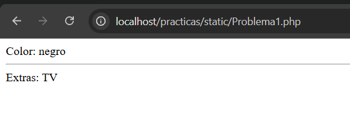
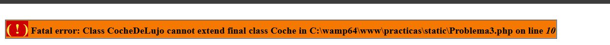
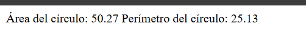

# 🧩 Práctica de POO en PHP - Herencia, Late Static Binding y Clases Finales

Este repositorio contiene la práctica de Programación Orientada a Objetos (POO) que desarrollé en PHP. Son cinco problemas que cubren herencia, métodos estáticos con `static::` y `self::`, clases `final`, una clase para figuras geométricas y una jerarquía de clases `Persona → Estudiante / Docente`.

Temas que se practicaron:

- Clases, objetos, propiedades y métodos
- Modificadores de acceso (`public`, `protected`, `private`)
- Herencia con `extends` y sobrescritura de métodos
- Constructores y `parent::__construct()`
- Métodos estáticos y *Late Static Binding* (`static::` vs `self::`)
- Clases `final` (impedir la herencia)
- Constantes matemáticas (`M_PI`) y formato de números con `number_format()`
- Modularización con `require_once`

---

## 🌐 Tecnologías utilizadas

- PHP 7.4 o superior (usa propiedades tipadas)
- Apache (a través de WampServer)
- WampServer

---

## ⚙️ Requisitos

Se necesita un entorno local con PHP. En mi caso trabajé con **WampServer**, que reúne Apache, MySQL y PHP en una sola instalación para Windows (en esta práctica MySQL no se usa). También se puede ejecutar cada archivo desde la terminal con `php archivo.php`.

📌 **Nota:** las propiedades tipadas como `private float $radio;` requieren **PHP 7.4 o superior**.

**Editor de Código:**
- Visual Studio Code

---

## 📁 Estructura del proyecto

```
Practica-POO/
├── img/
├── problema1/
│   ├── Coche.php              → clase padre
│   ├── CocheDeLujo.php        → clase hija
│   └── index.php              → prueba de la herencia
├── problema2/
│   ├── EjemploLateStatic.php  → versión con static::
│   └── EjemploSelf.php        → versión con self::
├── problema3/
│   └── ClaseFinal.php         → clase final que no se puede heredar
├── problema4/
│   └── Circulo.php            → área y perímetro de un círculo
├── problema5/
│   ├── Persona.php            → clase base
│   ├── Estudiante.php         → hereda de Persona
│   ├── Docente.php            → hereda de Persona
│   └── index.php              → prueba de ambas clases
└── README.md
```

---

## ✅ Qué hace cada problema

### Problema #1 - Herencia con `Coche` y `CocheDeLujo`

`Coche` es la clase padre: tiene la propiedad `protected $color`, sus métodos `setColor()` y `getColor()`, y `printCaracteristicas()`. `CocheDeLujo extends Coche` agrega la propiedad `$extras` con su `setExtras()` / `getExtras()` y **sobrescribe** `printCaracteristicas()` para mostrar color y extras.

Como `$color` es `protected`, la clase hija puede usarla directamente con `$this->color`.

```php
$miCoche = new CocheDeLujo();
$miCoche->setColor('negro');
$miCoche->setExtras('TV');
$miCoche->printCaracteristicas();
```

**Resultado:**

```
Color: negro
----------------
Extras: TV
```

**Captura de pantalla:**



⚠️ **Error que corregí:** en el enunciado original, `Coche::printCaracteristicas()` llamaba a `$this->getColor;` sin paréntesis. PHP lo interpreta como una propiedad inexistente y lanza `Warning: Undefined property`. Lo correcto es `$this->getColor()`.

---

### Problema #2 - `static::` vs `self::` (Late Static Binding)

`A` define `miFuncion()` y `otraFuncion()`. `B extends A` sobrescribe `miFuncion()`. Luego se llama `B::otraFuncion()`, que es un método heredado de `A`. Se probó cambiando solo una palabra dentro de `otraFuncion()`:

| Versión | Código dentro de `otraFuncion()` | Resultado | Por qué |
|---|---|---|---|
| Late Static Binding | `static::miFuncion();` | **B** | `static` se resuelve en tiempo de ejecución y apunta a la clase desde la que se hizo la llamada (`B`) |
| Early Binding | `self::miFuncion();` | **A** | `self` se resuelve donde se escribió el código y siempre apunta a la clase que lo contiene (`A`) |

**Captura con `static::` (resultado: B):**


**Captura con `self::` (resultado: A):**


📌 **Conclusión:** usa `static::` cuando quieras que una clase hija pueda cambiar el comportamiento; usa `self::` cuando quieras que siempre se use la versión de la clase donde está escrito el código.

---

### Problema #3 - Impedir que una clase pueda heredarse

La palabra `final` delante de `class` evita que otra clase extienda a la clase marcada.

```php
final class Coche
{
    public function getColor() { echo "Rojo"; }
}

class CocheDeLujo extends Coche {}   // ❌ error
```

**Resultado:**

```
PHP Fatal error:  Class CocheDeLujo cannot extend final class Coche
```

**Captura de pantalla:**



> El error se produce al cargar el archivo, antes de ejecutar cualquier otra línea. También existe `final` para métodos individuales, que evita que se sobrescriban.

---

### Problema #4 - Clase `Circulo` (área y perímetro)

Recibe el radio en el constructor y calcula:

- **Área:** `π × r²`
- **Perímetro:** `2 × π × r`

Usa la constante nativa `M_PI` (más precisa que escribir `3.1416`) y `number_format()` para mostrar dos decimales.

**Resultado con radio 4:**

```
Área del círculo:        50.27
Perímetro del círculo:   25.13
```

**Captura de pantalla:**



> Con `PI = 3.1416` el área sería 50.2656; con `M_PI` es 50.26548…, y al redondear a dos decimales ambas dan **50.27**.

---

### Problema #5 - Jerarquía `Persona → Estudiante / Docente`

Se separan los datos comunes (en `Persona`) de los datos propios de cada rol (en las clases hijas):


**`Persona`** (clase base): `nombre`, `apellido`, `fechaNacimiento`.

**`Estudiante extends Persona`**:

| Atributo | Valores |
|---|---|
| `indiceAcademico` | `float` (promedio) |
| `cohorte` | año de ingreso, por ejemplo `2023` |
| `estadoAcademico` | `0` Inactivo, `1` Activo, `2` Retirado, `3` Graduado |
| `modalidadEstudio` | `1` Presencial, `2` Virtual, `3` Híbrida |

**`Docente extends Persona`**:

| Atributo | Ejemplo |
|---|---|
| `codigoDocente` | `D-0042` |
| `departamento` | Sistemas Computacionales |
| `categoria` | Titular, Adjunto, Especial o Interino |
| `maximoTitulo` | Licenciado, Magíster, Doctor/PhD |
| `contratacion` | Tiempo Completo, Tiempo Parcial o Por horas |

Los constructores de las hijas llaman a `parent::__construct($nombre, $apellido, $fechaNacimiento)` para inicializar los datos de `Persona`.

**Resultado de `problema5/index.php`:**

```
El nombre del estudiante es: Juan
El apellido del estudiante es: Pérez
La fecha de nacimiento del estudiante es: 2000-05-15
El índice académico del estudiante es: 3.5
El cohorte del estudiante es: 2023
El estado académico del estudiante es: 1
La modalidad de estudio del estudiante es: 1
------------------------------------------
El docente es: Ana Gómez
Departamento: Sistemas Computacionales
Categoría: Titular
```

**Captura de pantalla:**


---

## 🧠 Conceptos clave

| Concepto | Explicación breve |
|---|---|
| `protected` | La propiedad es visible en la clase y en sus hijas, pero no desde afuera |
| `extends` | Una clase hereda propiedades y métodos de otra |
| Sobrescritura | La clase hija redefine un método del padre con el mismo nombre |
| `parent::` | Permite llamar a un método o constructor de la clase padre |
| `self::` | Apunta a la clase donde está escrito el código |
| `static::` | Apunta a la clase que realmente hizo la llamada (Late Static Binding) |
| `final` | Impide heredar la clase (o sobrescribir el método) |
| `M_PI` | Constante de PHP con el valor de π |

---

## 📋 Cumplimiento de la práctica

| Requerimiento | Dónde se cumple |
|---|---|
| Herencia entre `Coche` y `CocheDeLujo` | `problema1/` |
| Probar `static` y `self` y comparar resultados | `problema2/` |
| Impedir que una clase pueda heredarse | `problema3/ClaseFinal.php` |
| Clase para calcular área y perímetro de un círculo | `problema4/Circulo.php` |
| `Persona` con hijas `Estudiante` y `Docente` | `problema5/` |

---

## 📊 Estadísticas

| Creado | Watchers | Visitors |
|---|---|---|
| 08-10-2026 | 0 | 1 |

---

## 🛠️ Cómo usar este repositorio

1. Clona el repositorio y colócalo dentro de la carpeta `www` de WampServer (o `htdocs` si usas XAMPP):

```bash
git clone https://github.com/SicParvisMagnaD/Practica-POO.git
```

2. Con el servidor activo, abre en el navegador el problema que quieras probar:

   - `http://localhost/Practica-POO/problema1/index.php`
   - `http://localhost/Practica-POO/problema2/EjemploLateStatic.php`
   - `http://localhost/Practica-POO/problema2/EjemploSelf.php`
   - `http://localhost/Practica-POO/problema3/ClaseFinal.php`
   - `http://localhost/Practica-POO/problema4/Circulo.php`
   - `http://localhost/Practica-POO/problema5/index.php`

3. También puedes ejecutarlos desde la terminal, dentro de la carpeta del problema:

```bash
php index.php
```

📌 En el Problema #3 el **Fatal error es el resultado esperado**: demuestra que `final` está funcionando.

---

## 👤 Autor

**Javier Vallarino**<br>
Estudiante de Licenciatura en Ciberseguridad<br>

Universidad Tecnológica de Panamá <br>
Facultad de Sistemas Computacionales<br>
Grupo: 1S3122<br>
Unidad: Programación de Aplicaciones Web<br>
II Semestre<br>

📧 Email: javier.vallarino@utp.ac.pa<br>
🌐 GitHub: [SicParvisMagnaD](https://github.com/SicParvisMagnaD)